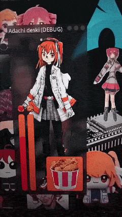

# Adachi-Deski
Adachi rei as a silly desktop companion, she's just happy to be there :)

### Get the lastest release [here](https://github.com/Mejolov24/Adachi-Deski/releases/latest)

## Features:
 - Pet her
 - Feed her
 - Update checking

## Pending:
 - [ ] Boot animation
 - [ ] Shaders
 - [ ] Settings

## Contributing
[Pull requests](https://github.com/Mejolov24/Adachi-Deski/pulls) are welcome! Any reasonable feature or improvement is appreciated.

### Rules
 - **Content** No NSFW content
 - **Art Style** must use HEPT32 color pallet for sprites, except realistic sprites like rei, for her, any is welcome, even full color
 - **AI** While AI usage is accepted for coding help, you cannot:
    - Use an AI agent to do it for you
    - Use Generative AI for art

## Bug report
 - When you find a bug, open an [issue](https://github.com/Mejolov24/Adachi-Deski/issues) describing the steps to recreate, your OS and architecture.

Made in the godot engine.
Liscensed under the MIT liscence.